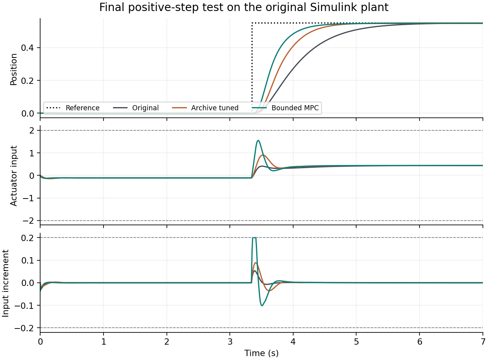

# 从归档二阶 Simulink 对象到可调用的约束 MPC

同一个连续二阶对象上，原控制器、原控制器调权和新约束控制器在首次执行的最终测试中，位置 RMSE 分别为 **0.14844、0.12263、0.10263**。相对原版调权，约束版 RMSE 下降 16.3%，执行器 RMS 增加 7.3%。较大阶跃的验证工况暴露出原版调权的 13 个幅值越界样本和 5 个速率越界样本，约束版两项均为零。所有闭环数字来自 R2024b 原生 Simulink 仿真。[四工况十二条时序的指标](../../runs/native-mpc/report.json) · [可直接打开的约束模型](../../runs/native-mpc/native_mpc_corrected.slx)

## 1　先确定运行的是哪一份控制器

| 输入 | 如何使用 | 现场检查结果 |
|---|---|---|
| 55 子目录的 LMPC 模型、model_param.mat、运行脚本 | 原始闭环及三种控制器的统一评测对象 | 参数向量顺序为 [a,c,b,f0]，顶层 Constant42 读取 R1，模型没有 y/r/u 三个 To Workspace |
| 素材顶层的同名 SLX 和自动调参脚本 | 原样运行 fmincon，再把选出的权重映射到 55 模型的 R1 | 顶层副本 Constant42 读取 R，导出 y/r/u，两个 SLX 的 SHA-256 不同 |
| 顶层 MPC_QP.m | 比对源码，导出实际优化矩阵 | 换行规范化后与两份模型内嵌的 MATLAB Function 代码一致。更改外部 m 文件不会直接更新已嵌入的代码 |

原控制器路径为 `LMPC_2nd_order_Kang_2/linear MPC without constrant/tuixiangzi_ZL`，块 SID 为 187。作者用 MATLAB Function 块实现无约束线性方程求解。内部名为 `sf_sfun` 的 S-Function 由 Stateflow 包装生成。源码和连线里没有 MPC Toolbox 控制器块、用户编写的 S-Function 或在线 `quadprog` 调用。顶层脚本在离线调参时使用 Optimization Toolbox 的 `fmincon`。[55 原模型](../../../素材/55-系统辨识MPC-ADRC-PID/LMPC_2nd_order_Kang_2.slx) · [顶层原模型](../../../素材/LMPC_2nd_order_Kang_2.slx) · [源函数](../../../素材/MPC_QP.m) · [完整路径、连线及哈希](../../runs/native-mpc/source-audit.json)

## 2　恢复真实反馈、采样与基线

- `plant model/2nd_order_dynamic` 的两个积分器产生位置 x₁ 和速度 x₂。对象满足 ẋ₁=x₂，ẋ₂=c·x₁+a·x₂+b·u+f₀。四个参数按文件顺序约为 [−4.16238, −8.85661, 8.86259, 0.98279]。仿真直接反馈两个状态，素材未规定物理单位，也未提供速度观测器。[四参数文件](../../../素材/55-系统辨识MPC-ADRC-PID/model_param.mat)
- 原始设计工况是 0–10 s，5 s 位置指令由 0 跳到 1，速度指令为 0。`TD` 先滤波，时间常数为期望稳定时间 1 s 的四分之一。`TD` 的第一输出是送入控制器的二维参考，第二输出进 Terminator。在线以当前滤波参考作时域内恒值预测。外部评分使用原始指令 `r`。[源端口与参数](../../runs/native-mpc/source-audit.json)
- 控制器取当前状态及其相邻采样差，输出第一个 Δu。`Add` 将其与 `Delay` 中的前一实际 u 相加，结果同时进入对象和延迟。原预测模型用前向 Euler，N=10，Q=diag(1,0.015)，R1=0.1。原图的控制器扰动端接常数 0，对象内部有 f₀。[原始权重](../../../素材/55-系统辨识MPC-ADRC-PID/Run_MPC_For_2nd_order_Plant.m) · [实测原始轨迹](../../runs/native-mpc/design-original.csv)
- 固定步长和预测模型的 Ts 都是 0.01 s。实际编译后，原 MATLAB Function 的采样时间是 [0,0]（连续），Delay 为 [0.01,0]，两只对象积分器均为 [0,0]。约束版本将 MATLAB Function 显式设为 [0.01,0]。日志在 0.01 s 主步上核验前一动作及累加关系。[编译后的采样表](../../runs/native-mpc/native-verification.json)

## 3　检查每个未来动作对后续状态的影响

原源码第一列填满全部预测步。对之后每个增量，程序只写入它首次生效的两行，此后该列保持为零。试验在临时副本中仅增加原函数的输出参数，将运行得到的 20×10 矩阵送入库的独立逐步递推检验。每次只激励一个控制增量。第 1、10 列通过，第 2–9 列失败。只激励第 2 列时，第 3 步位置预测为 0.29670587，递推为 0.29759213，误差为 −0.00088626。这项试验隔离了增量输入映射，无法由一次闭环 RMSE 单独替代。[原函数矩阵](../../runs/native-mpc/archived-matrix.json) · [逐列报告](../../runs/native-mpc/prediction-probes.json) · [运行与取证程序](verify_native_evidence.m)

## 4　复现原版离线调参

顶层脚本从 [Q2,R]=[1,1] 起步，边界分别为 [1e−5,10]、[1e−6,1]。它对正阶跃的时间加权平方跟踪误差与输入平方求和，两项都乘 0.1。实际日志间隔为 0.01 s，因此归档评分值与按实际主步积分的量纲尺度相差约十倍。该共同常数不改变候选间的排序。脚本捕捉数据提取异常后会返回 1e6，调用 sim 本身在 try 之前。本次实际目标值为 59.88014，第 12 轮迭代累计评估 43 次，得到 Q2=0.00600918、R=0.09347477。将 R 映射至 55 模型的 R1，即可获得表中的“原版调权”。[原调参脚本](../../../素材/Run_MPC_For_2nd_order_Plant_auto_tuning.m) · [原样重跑程序](replay_archive_tuning.m) · [运行记录](../../runs/native-mpc/archived-fmincon-log.txt)

## 5　用固定维数的约束控制器替换原块

直接 MATLAB 接口返回绝对动作、求解状态及两个未来绝对动作。输入都是 double，Ad 为 2×2，Bd、Ed、x、r 均为 2×1，Q 为 2×2 对角矩阵。标量 previous 取执行器上一拍实际动作，d 取当前可用的加速度偏置，本例使用归档 f₀。每次采用当前参考和偏置，并在时域内保持。下例使用本案例参数。

```matlab
p = load('../素材/55-系统辨识MPC-ADRC-PID/model_param.mat').x_model;
Ts = 0.01;
Z = expm([0 1 0 0; p(2) p(1) p(3) 1; zeros(2,4)] * Ts);
[u,status,plan] = native_mpc_step(Z(1:2,1:2),Z(1:2,3),Z(1:2,4), ...
    [0;0],0,[1;0],p(4),diag([1 .002]),.01,Ts);
```

预测方程为 x⁺=Ad·x+Bd·u+Ed·d，通过增广矩阵指数获得零阶保持离散模型。预测 10 步，控制 2 步，第二个动作保持到第 10 步。目标为

$$
\min_{u_0,u_1}\sum_{i=0}^{9}\left[(x_{i+1}-r)^\top Q(x_{i+1}-r)+10^{-4}u_i^2\right]
 +R\left[(u_0-u_{-1})^2+(u_1-u_0)^2\right].
$$

硬约束为 |u|≤2、|Δu|≤20·Ts。幅值、速率及绝对输入代价 10⁻⁴ 均是本例新增设计假设。位置和速度通过 Q 进入代价，未指定硬状态边界。求解器检查无约束最优点、六条约束边界上的最优点和可行顶点，从可行点中取代价最低者。输入满足界限时，“保持上一动作”总是可行。接口状态 1 表示选到最优点，0 返回上一动作；模型集成在状态异常时触发断言。上车使用时需另定故障处理策略。[预测器](native_mpc_prediction.m) · [控制器](native_mpc_step.m)

接入时用上一实际 u 替换原端口 9 的 Δx，端口 5–7 接离散 Ad/Bd/Ed，扰动端接 f₀。适配器将绝对决策转换为 u−previous，沿用原有的加法器、执行器延迟、TD 和连续对象。在正常输入域内，40 个独立随机测试同时覆盖两列预测、混合动作和非零偏置。与逐步状态递推比对，最大状态差为 2.67×10⁻¹⁵；与独立 `quadprog` 的两个计划动作最大差为 3.12×10⁻¹⁰，36 个首动作触及幅值或速率边界。[副本接线程序](build_native_copy.m) · [独立代价/求解器核验](test_native_mpc.m) · [数值报告](../../runs/native-mpc/report.json)

## 6　设计工况筛选，验证工况选型，最后换工况测试

2026-11-26 12:33:46 UTC 冻结四个工况、六组 [Q2,R] 候选及入选规则。Q1 固定为 1，外评分为位置 RMSE + 0.01·RMS(u)/2 + 0.01·RMS(Δu)/0.2。两项执行器指标分别以本例的幅值和单步变化上限归一化。约束版任一步越界即报错。[冻结协议](protocol.json) · [闭环执行与评分](run_native_mpc.m)

1. **调参筛选。** 在原正阶跃上评估六组，取外评分最低的 2、3、6 号候选进入验证。
2. **独立选型。** 在 1.8 s 跳至 +1.35 的新验证工况上，三个候选评分分别为 0.281279、0.290537、0.310168。程序将胜出的 2 号 [0.002,0.01] 及候选、工况、时间写入 selection.json。首次落盘时间为 12:35:19.078 UTC。[选型记录](../../runs/native-mpc/selection.json)
3. **历史回归。** 2.75 s 跳至 −0.8 的工况在前一次两工况试验中已被查看；本轮用于复验。原版和原版调权的历史对照指标已逐项重算并比对。[前一次试验原始报告](../../runs/native-mpc/previous-two-scenario-report.json)
4. **全新最终测试。** 3.35 s 跳至 +0.55、7 s 结束的工况在选型落盘后才首次运行，启动时间为 12:35:29.848 UTC。所有控制器共用参考和对象。此次测试未参与候选排序。[验收记录](../../runs/native-mpc/acceptance.json)

| 指令工况 | 方案 | 位置 RMSE | RMS(u) | 峰值绝对 u | 峰值绝对 Δu | 幅值/速率越界样本 |
|---|---|---:|---:|---:|---:|---:|
| 正阶跃，1001 点 | 原版 | 0.22585 | 0.59895 | 0.88839 | 0.09654 | 0 / 0 |
| 同上 | 原版调权 | 0.18659 | 0.64544 | 1.73642 | 0.16128 | 0 / 0 |
| 同上 | 约束 MPC | 0.16507 | 0.66549 | 2.00000 | 0.20000 | 0 / 0 |
| 验证强阶跃，751 点 | 原版 | 0.35199 | 1.03033 | 1.23819 | 0.13033 | 0 / 0 |
| 同上 | 原版调权 | 0.29082 | 1.09827 | 2.38298 | 0.21773 | 13 / 5 |
| 同上 | 约束 MPC | 0.27423 | 1.10433 | 2.00000 | 0.20000 | 0 / 0 |
| 历史负阶跃，801 点 | 原版 | 0.20198 | 0.70943 | 0.91033 | 0.07723 | 0 / 0 |
| 同上 | 原版调权 | 0.16687 | 0.74921 | 1.58874 | 0.12903 | 0 / 0 |
| 同上 | 约束 MPC | 0.14419 | 0.76649 | 2.00000 | 0.20000 | 0 / 0 |
| 全新最终测试，701 点 | 原版 | 0.14844 | 0.30044 | 0.43839 | 0.05310 | 0 / 0 |
| 同上 | 原版调权 | 0.12263 | 0.33608 | 0.90513 | 0.08871 | 0 / 0 |
| 同上 | 约束 MPC | 0.10263 | 0.36060 | 1.54901 | 0.20000 | 0 / 0 |

比较同时改变了采样、预测、控制时域、偏置处理及权重，因此不能将全部改善归给某一项修复。素材没有传感器噪声、执行器延迟标定或硬件时限数据。每条 CSV 保留 t、原始参考 r、滤波位置参考 rf、位置 y、速度 v、previous、u 和 Δu。[最终测试原版](../../runs/native-mpc/fresh_test-original.csv) · [最终测试原版调权](../../runs/native-mpc/fresh_test-archive-tuned.csv) · [最终测试约束版](../../runs/native-mpc/fresh_test-corrected.csv)



## 7　从项目根目录复跑

使用 MATLAB R2024b、Simulink、Stateflow。归档优化和独立对照使用 Optimization Toolbox，可部署 MATLAB 控制函数本身采用固定维数的求解算法。MATLAB Coder 生成了独立 C 源码。首次本机 MEX 执行中，两步计划及首动作与 MATLAB 结果完全一致。三阶段试验后重建 MEX 成功，但 Windows 应用程序控制策略阻止加载那份新二进制。常规复跑保留 C 源生成，目标硬件及执行时间上限仍需在目标平台验证。重新加载交付的 SLX，使用模型工作区默认值，时间、动作、位置与所选设计轨迹的最大差为 4.67×10⁻¹⁵。[最终模型及编译记录](../../runs/native-mpc/native-verification.json) · [首次本机 MEX 结果](../../runs/native-mpc/previous-host-mex-verification.json) · [再次构建及加载记录](../../runs/native-mpc/host-mex-retest.json)

```powershell
$py = '..\control-agent-harness\.venv\Scripts\python.exe'
& $py cases/native-mpc/audit_source.py ../素材 runs/native-mpc/source-audit.json
matlab -batch "addpath(fullfile(pwd,'cases','native-mpc')); replay_archive_tuning('../素材','runs/native-mpc'); run_native_mpc('../素材','runs/native-mpc'); verify_native_evidence('../素材','runs/native-mpc');"
& $py cases/native-mpc/check_prediction.py runs/native-mpc
& $py cases/native-mpc/check_closed_loop.py runs/native-mpc
```

要单独使用交付模型，先将 `cases/native-mpc` 加入 MATLAB 路径，再打开 `runs/native-mpc/native_mpc_corrected.slx`。模型工作区包含所选参数和离散矩阵，控制器调用 cases/native-mpc 中的两个 MATLAB 函数。复跑命令在临时目录装入原件副本，并写入案例专用结果目录。[模型](../../runs/native-mpc/native_mpc_corrected.slx) · [直接控制接口](native_mpc_step.m)

## 8　角色技能迁移到此项目时实际用到的部分

| 现场步骤 | 可直接复用 | 此例所需的适配 |
|---|---|---|
| 确认接口 | 角色技能要求先列出信号、采样、约束及扰动来源 | 针对同名 SLX 做路径、指纹与工作区变量比对，读 MATLAB Function 代码和真实连线，编译检查块、延迟、对象各自的采样时间 |
| 预测核验 | 库的 `controlkit.prediction.check` 接受用户矩阵，可报告首次失败的步和通道 | 从实际运行的源函数取出矩阵，逐一激励每个未来动作列；对有限控制时域的约束版按实际保持策略单独测试 |
| 设计与调参 | 固定候选、外评分和独立工况，可保留动作变化与跟踪指标 | 弹簧示例的工厂入口采用 Python 对象与力/位移约定。此例写原生仿真适配器，在真实状态单位未知时明确执行器边界是假设，并使用源模型的 TD 和偏置 |
| 交付 | 每种控制器输出同格式逐时刻数据 | 给出源函数与 SLX、保存选定参数至模型工作区、重新打开后复跑、检查生成 C 及本机 MEX |

[MPC 角色技能](../../.agents/skills/design-and-tune-mpc/SKILL.md) · [增量核验技能](../../.agents/skills/verify-mpc-prediction/SKILL.md) · [约束调参技能](../../.agents/skills/tune-constrained-mpc/SKILL.md)
